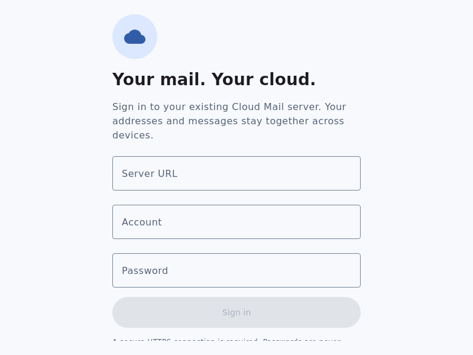
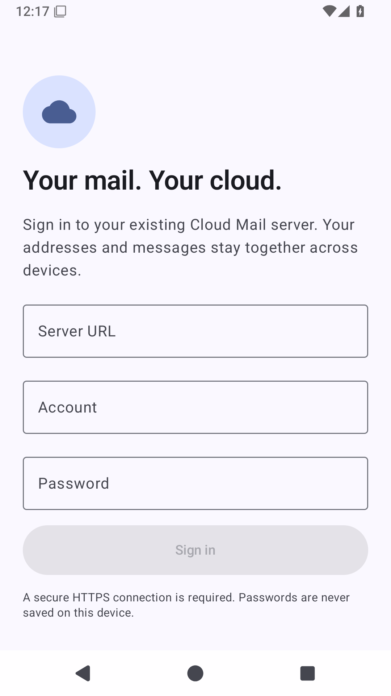

# Native UI validation

This record separates images from executed interaction assertions. All mailbox images use an isolated test account and synthetic mail. No production mail server, account or external recipient is involved.

## Packaged Linux application

The generated DEB was extracted and its bundled executable launched on an Xorg dummy display. The screenshot below is from the actual Compose application, not a WebView or a design mockup. Inspection found aligned fields, readable contrast and a visible primary action at 800 × 600. The login form scrolls when content exceeds the window height.

The restricted test host required writable Skiko/cache directories and a test-only Fontconfig configuration selecting DejaVu Sans TrueType fonts. Its default WOFF2 font previously triggered a native Skia crash before assertions. No platform-specific test override is shipped in the client.

## Automated fixtures

`UiSmokeTest.kt` uses a real MailViewModel, in-memory SQLDelight and Ktor MockEngine. It explicitly sizes its Compose desktop test scenes at 320 × 640, 420 × 780 and 1280 × 900, and includes login, inbox, detail, reply composition, settings, light/dark, 150% type, offline/retry and keyboard commands.

The first complete native UI run executed all seven fixtures: six passed and the expanded-layout assertion found two “YOUR ADDRESSES” nodes. The closed modal drawer was still composed beside the permanent expanded sidebar. The app now composes drawer content only below the expanded breakpoint, removing the duplicated navigation from that layout. The next complete run passed all seven UI fixtures. The original failure is retained in this record. Screenshot inspection then identified that expanded mode hid the top bar without providing a visible search action. A search button was added to the expanded message-list header, with a displayed-action assertion; the final targeted UI run also passed all seven fixtures, including the new displayed-search assertion (JUnit XML timestamp `2026-10-20T00:06:54.895Z`).

Actual captures inspected from that run:

| Capture | Inspection |
| --- | --- |
| [Expanded inbox](screenshots/inbox-expanded.png) | 1280 × 900; permanent sidebar, message list and reading pane have distinct widths, visible Search, and no duplicated navigation. |
| [Compact inbox](screenshots/inbox-compact-light.png) | 420 × 780; sender, subject, timestamp, star and Compose remain distinct and readable. |
| [Message detail](screenshots/message-detail-compact.png) | Metadata and body fit, and reply actions wrap into available width. |
| [Reply composer](screenshots/composer-compact.png) | From/To/subject/editor and pinned save/discard actions remain reachable. |
| [Dark settings](screenshots/settings-compact-dark.png) | Separate dark surfaces, readable labels and visibly selected theme. |
| [150% dark composer](screenshots/composer-compact-dark-large-font.png) | 320 × 640; the title wraps, Send uses its own row, body scrolls and footer actions wrap. |

The large-type settings fixture also scrolled to Sign out and its assertion passed. The keyboard fixture passed Ctrl+K search, Escape dismissal and Ctrl+N composition. Offline cached mail remained visible and Retry restored the online state in the real ViewModel fixture. These tests do not validate OS screen-reader behavior, touch gestures on a device or real server delivery.

## Android API 35 startup

The actual hosted emulator install/startup check passed in run `39346174056` (source `0dee16d`). UIAutomator confirmed the native sign-in fields and button; AndroidRuntime error output was empty. The downloaded screenshot was inspected: system bars, edge-to-edge layout, fields, footer and disabled empty-form action are readable and reachable without overflow. This is an actual Android APK, not the Desktop fixture.

Device login/send, file-picker permissions, notification dialogs/background timing and rotation with unsaved input still require dedicated platform QA.

## macOS Intel evidence

Run 39467778176 at `b8f4e14` passed actual Desktop tests and DMG packaging on `macos-15-intel`. Downloaded artifact 12285054939 contains 50 discovered cases: 49 passed and the Linux-only actual Worker HTTP fixture case was explicitly skipped. Its expanded inbox and compact 150%-type dark composer screenshots were visually inspected and preserved as [inbox](screenshots/macos-intel-inbox.png) and [composer](screenshots/macos-intel-composer-large-dark.png). They use synthetic fixtures, not private mail. The composer screenshot intentionally reflects the scroll position reached during the interaction test. This does not certify signed installation or native Keychain permission prompts.
